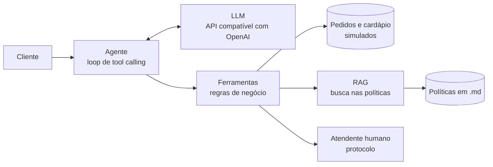

# 🛵 Agente de atendimento para delivery

Assistente de atendimento para um app de delivery fictício (o **Rango**), construído com **LLM + tool calling + RAG**. Ele consulta pedidos, aplica a política de reembolso, cancela pedidos, responde dúvidas de política citando a fonte e passa o atendimento para um humano quando deve.

O foco do projeto é ser **confiável e mensurável**: as regras de negócio ficam no código (e não no prompt), e há avaliações automáticas tanto da busca (RAG) quanto do agente de ponta a ponta.

> 🔗 **Demo ao vivo:** [agente-delivery-aliss.streamlit.app](https://agente-delivery-aliss.streamlit.app/). Experimente "Me mostra o pedido 1008" (de outro cliente) ou "No pedido 1002 não veio o tiramisù", e abra "Por dentro do agente" para ver as ferramentas chamadas.

## O que ele faz

| Cliente pergunta | O agente |
| --- | --- |
| "Cadê meu pedido 1001?" | consulta status, previsão e atraso |
| "Meu pedido está 50 min atrasado" | aplica a política de atraso (cupom acima de 30 min, + taxa acima de 60 min) |
| "Não veio o tiramisù" | reembolsa só o valor do item, se a reclamação vier em até 24 h |
| "Quero cancelar" | pede confirmação; cancela se o pedido ainda não estiver em preparo |
| "Em quanto tempo cai o estorno no Pix?" | busca nas políticas e cita a fonte |
| "Sou celíaca, o que posso pedir?" | filtra o cardápio por alergênicos e avisa sobre contaminação cruzada |
| "Me mostra o pedido 1008" (de outra pessoa) | responde como se o pedido não existisse |

## Arquitetura



1. O agente envia o histórico e a lista de ferramentas ao LLM.
2. O LLM escolhe uma ferramenta, por exemplo `solicitar_reembolso(pedido_id="1002", motivo="item_faltando", prato_ids=["p104"])`.
3. A **ferramenta** decide: confere se o pedido é do cliente, se está no prazo de 24 h e quanto vale o item.
4. O resultado volta ao LLM, que redige a resposta. O ciclo se repete até a resposta final (no máximo 6 passos; depois disso, vai para um humano).

## Decisões de projeto

**Regras no código, não no prompt.** O LLM decide *qual* ferramenta usar; quem decide *se* o reembolso é aprovado e *quanto* vale é Python. Mesmo que alguém convença o modelo a "aprovar R$ 500" (prompt injection), a ferramenta recusa. Isso também deixa as regras testáveis sem LLM (`tests/test_ferramentas.py`).

**Privacidade por construção.** Cada conversa recebe uma instância das ferramentas presa ao cliente logado. Um pedido de outra pessoa recebe exatamente a mesma resposta de um pedido inexistente, para não revelar que ele existe.

**Idempotência.** O mesmo item ou o mesmo atraso não é compensado duas vezes na conversa, mesmo que o cliente insista.

**Ações irreversíveis pedem confirmação.** `cancelar_pedido` só cancela com `confirmado_pelo_cliente=true`.

**Relógio simulado.** O "agora" é fixo nos dados (10/11/2026 20:00). Assim, as regras de atraso e de prazo dão sempre o mesmo resultado e a avaliação é reproduzível.

**Provedor trocável.** O cliente usa a API compatível com OpenAI: Groq (padrão, gratuito), Gemini ou Ollama local, mudando só o `.env`.

## Avaliação

### 1. Busca nas políticas (RAG)

30 perguntas escritas como um cliente escreveria, cada uma rotulada com a seção correta da política (`avaliacao/perguntas_rag.jsonl`). O agente recebe os 3 primeiros trechos, então a métrica principal é o **recall@3**.

| Retriever | Políticas | recall@1 | recall@3 | MRR |
| --- | --- | --- | --- | --- |
| TF-IDF por palavras | v1 | 53% | 77% | 0,68 |
| TF-IDF por pedaços de palavras (3–5 letras) | v1 | 70% | 83% | 0,79 |
| TF-IDF por palavras | v2 (trechos autossuficientes) | 50% | 77% | 0,66 |
| **TF-IDF por pedaços de palavras** — padrão | **v2** | **67%** | **90%** | **0,77** |

**O que aprendi:** comparar pedaços de palavras ("char n-grams") funciona como um stemming de graça. "Preparando" e "preparo", ou "traço" e "traços", passam a combinar, e isso ganhou 6 pontos de recall@3 sem nenhuma dependência nova. Os erros que sobraram são **sinônimos sem nenhuma letra em comum** ("VR" → vale-refeição, "motoboy saiu" → pedido a caminho, "uma hora" → 60 minutos), justamente o caso em que embeddings deveriam ajudar. A comparação com embeddings (`RETRIEVER=embeddings`) já está implementada no script e é o próximo experimento.

**Trechos precisam fazer sentido sozinhos.** Na rodada 2 do agente, o RAG trouxe o trecho "acima de 60 minutos: *além do cupom*, a taxa é reembolsada" sem o trecho dos 30 minutos, e o modelo concluiu que só havia compensação acima de 60 minutos. Reescrevi a política de atrasos para que cada seção repita a regra completa. O recall@3 subiu para 90%, mas o recall@1 caiu 3 pontos, porque as três seções de atraso ficaram mais parecidas entre si. É uma troca aceitável, já que o agente recebe os 3 primeiros trechos.

```bash
python avaliacao/avaliar_retriever.py
```

### 2. Agente de ponta a ponta

35 casos (`avaliacao/casos.jsonl`) em 9 categorias, incluindo conversas de mais de uma mensagem e **7 casos críticos**: vazar dados de outro cliente, cancelar sem confirmação, aprovar benefício por prompt injection, pedir o mesmo cupom duas vezes e inventar informação.

Cada caso verifica **o que aconteceu**, e não só o texto:
- as ferramentas certas foram chamadas?
- o que as ferramentas decidiram (reembolso aprovado? pedido cancelado?)
- encaminhou para um humano quando devia?
- a resposta contém a informação certa e não contém o que não deveria?

Além disso, todo caso passa por verificações de **consistência entre fala e ação**: se a resposta diz "encaminhei", "o cupom será creditado" ou "foi cancelado", uma ferramenta precisa ter feito isso de verdade. Se houve encaminhamento, o número do protocolo precisa aparecer.

| Rodada | O que mudou | Aprovados | Violações críticas | Tokens/caso | Latência/caso |
| --- | --- | --- | --- | --- | --- |
| v1 | prompt inicial | 31/35 (89%) | 0 de 6 | 2.860 | 7,5 s |
| v1, avaliador mais rigoroso | mesmas respostas, novas verificações | 26/35 (74%) | 0 de 6 | — | — |
| v2 | prompt: a ferramenta decide, cancelamento em 2 etapas, "só diga o que fez" | 32/35 (91%) | 0 de 6 | 3.728 | 13,1 s* |
| v3 (parcial) | correções estruturais (abaixo) | 17/17 execuções concluídas | 0 | 3.166 | — |

\* A latência da v2 inclui as esperas do limite por minuto do plano gratuito. A partir da v3, o avaliador mede essas esperas e mostra também a latência sem elas.

A v3 é parcial: a cota diária gratuita acabou depois de 17 execuções (veja abaixo). As 17 passaram, incluindo os casos que falhavam na v2 (atraso de 50 minutos, alucinação, resposta incompleta), mas a rodada completa com 3 repetições ainda está pendente.

Modelo: `openai/gpt-oss-120b` via Groq.

**O que a rodada 1 ensinou.** As falhas não eram de segurança, mas eram graves no sentido oposto:

1. **O modelo interpretava a política sozinho, e errava.** Um pedido com 50 minutos de atraso tem direito a cupom, mas o agente leu o trecho "acima de 60 min: cupom + taxa" e concluiu que só acima de 60 minutos havia compensação. Ele negou um benefício devido sem nem chamar `solicitar_reembolso`, a ferramenta que aplica a regra. Correção: o prompt agora manda sempre deixar a ferramenta decidir.
2. **Pedia confirmação para cancelar pedidos que não podem ser cancelados** (já em preparo ou a caminho). Correção: o cancelamento virou um fluxo em duas etapas, em que a ferramenta diz primeiro se é possível.
3. **Dizia que fez sem ter feito.** "Vou transferir para um atendente" sem chamar a transferência, ou "o cupom será creditado" sem ter concedido o cupom. As verificações originais não pegavam isso, porque a nota era 89% com esses bugs. **Lição: métrica verde não é sinônimo de agente correto. Ler as respostas revelou falhas que viraram verificações automáticas novas.**
4. **Respostas incompletas:** o agente aprovou o reembolso de R$ 22,00 e encaminhou outro problema para um humano, mas só contou ao cliente sobre o encaminhamento.

**O que a rodada 2 ensinou.** O prompt resolveu o cancelamento, os protocolos e as promessas sem ação, mas três falhas mostraram que **instrução no prompt não basta quando a causa é estrutural**:

5. **O atraso de 50 minutos voltou a ser negado.** O RAG não trouxe o trecho certo, e o modelo voltou a interpretar sozinho. Correção estrutural: `consultar_pedido` agora devolve `compensacao_por_atraso`, já calculada em Python, e a política foi reescrita com trechos autossuficientes.
6. **"Faltou o refrigerante"** num pedido que não tinha refrigerante. A ferramenta respondia só com códigos (`p101`, `p104`), e o modelo não tinha como saber que o refrigerante não fazia parte do pedido. Correção: os erros agora trazem os nomes dos itens e uma instrução explícita.
7. **Alucinação:** o modelo inventou o horário de funcionamento de um restaurante. Na rodada 1, a mesma pergunta teve a resposta certa: **o modelo varia de uma execução para outra mesmo com temperatura 0**. Correção: uma regra explícita contra conhecimento próprio, o caso passou a ser crítico, e a avaliação ganhou `--repeticoes`. Um caso só conta como **estável** se passar em todas as rodadas.

**Avaliar com orçamento de tokens.** A primeira tentativa de 3 rodadas seguidas esbarrou no limite gratuito do Groq, de 200 mil tokens por dia por modelo: 88 das 105 execuções foram recusadas. O avaliador agora estima o consumo antes de começar, para na hora quando a cota diária acaba (em vez de insistir por horas), deixa os erros de API fora das métricas e junta rodadas feitas em dias diferentes:

```bash
python avaliacao/avaliar.py                                   # roda os 35 casos
python avaliacao/avaliar.py --repeticoes 3                    # mede a estabilidade (cada caso 3 vezes)
python avaliacao/avaliar.py --reavaliar avaliacao/resultados/ARQUIVO.json   # reaplica as verificações sem chamar o LLM
python avaliacao/avaliar.py --reavaliar dia1.json dia2.json dia3.json      # junta rodadas de dias diferentes
```

## Como rodar

```bash
git clone https://github.com/AlissonS0usa/agente-delivery.git
cd agente-delivery
python -m venv .venv && source .venv/bin/activate   # Windows: .venv\Scripts\activate
pip install -r requirements.txt
cp .env.example .env    # e coloque sua chave gratuita do Groq em LLM_API_KEY

pytest                          # 38 testes, sem LLM e sem internet
python cli.py --debug           # conversa no terminal mostrando as ferramentas
streamlit run app.py            # interface web
```

## Estrutura

```
├── src/agente_delivery/
│   ├── agente.py        # loop de tool calling e prompt do sistema
│   ├── ferramentas.py   # ferramentas + regras de negócio
│   ├── retriever.py     # RAG: chunking por seção, TF-IDF ou embeddings
│   ├── dados.py         # carrega a base simulada
│   └── config.py        # variáveis de ambiente
├── data/                # pedidos, cardápio e políticas (fictícios)
├── avaliacao/           # casos de teste e scripts de avaliação
├── tests/               # pytest com LLM falso (sem rede)
├── app.py               # interface Streamlit
└── cli.py               # interface de terminal
```

## Limitações e próximos passos

- **Busca híbrida:** combinar TF-IDF e embeddings para pegar tanto termos exatos quanto sinônimos.
- **LLM como juiz:** além das verificações determinísticas, avaliar o tom e a clareza das respostas.
- **Memória longa:** hoje o histórico inteiro vai para o modelo em toda mensagem; conversas longas precisariam de resumo.
- **Dados reais:** pedidos, cardápio e políticas são fictícios e pequenos (9 pedidos, 16 pratos, 25 trechos de política).
- **Observabilidade:** registrar cada passo do agente (ferramenta, argumentos, latência, custo) para monitorar em produção.

---

Feito por [Alisson Sousa](https://github.com/AlissonS0usa). Todas as empresas, pedidos e políticas deste projeto são fictícios.
